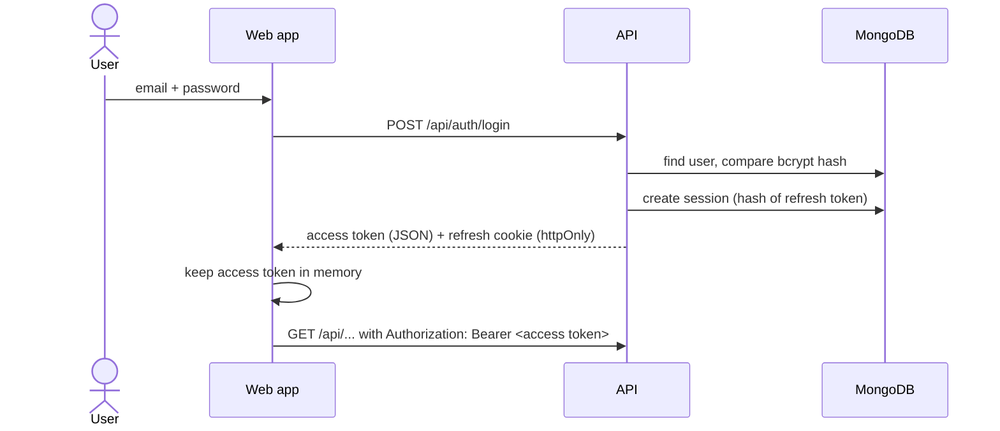
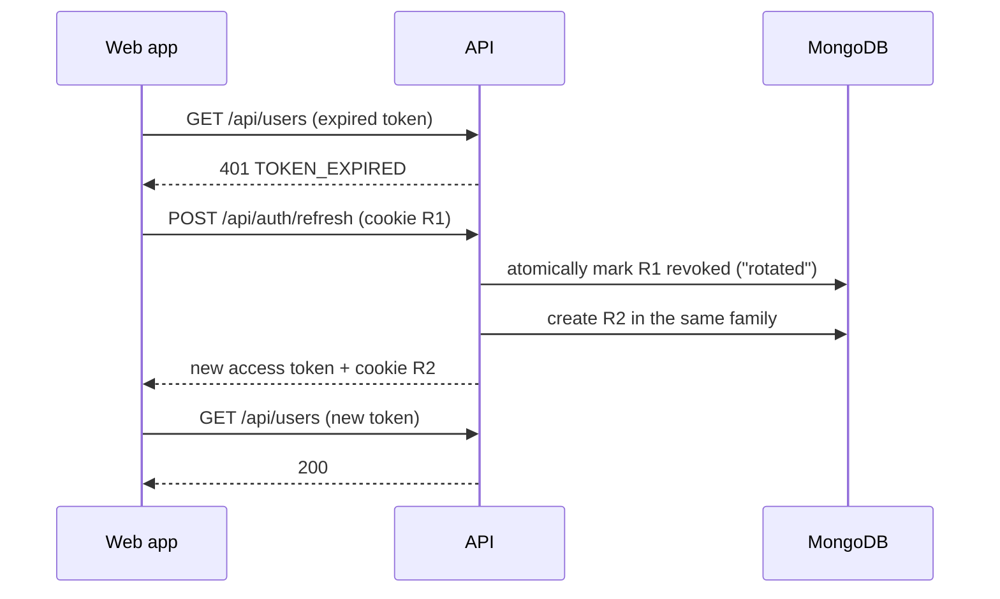

# Authentication & Roles

How users sign in, how sessions stay secure, and who can do what.

## Roles and permissions

Permissions are defined once in [`packages/shared/src/permissions.ts`](../packages/shared/src/permissions.ts).
The API enforces them on every route, and the web app uses the same list to hide menu items and
pages a user cannot use.

| Permission         | What it allows                           | Admin | Manager | Cashier |
| ------------------ | ---------------------------------------- | :---: | :-----: | :-----: |
| `users:manage`     | Add users, change roles, reset passwords |   ✓   |         |         |
| `settings:manage`  | Shop name, GSTIN, invoice prefixes       |   ✓   |         |         |
| `audit:read`       | View the audit log                       |   ✓   |         |         |
| `products:read`    | Look up products and prices              |   ✓   |    ✓    |    ✓    |
| `products:write`   | Add and edit products                    |   ✓   |    ✓    |         |
| `inventory:read`   | See stock levels and history             |   ✓   |    ✓    |    ✓    |
| `inventory:adjust` | Correct stock (damage, counts)           |   ✓   |    ✓    |         |
| `purchases:read`   | See purchase orders                      |   ✓   |    ✓    |         |
| `purchases:manage` | Create and receive purchase orders       |   ✓   |    ✓    |         |
| `sales:create`     | Bill customers at the POS                |   ✓   |    ✓    |    ✓    |
| `sales:read`       | View invoices                            |   ✓   |    ✓    |    ✓    |
| `returns:create`   | Process customer returns                 |   ✓   |    ✓    |    ✓    |
| `customers:read`   | Look up customers                        |   ✓   |    ✓    |    ✓    |
| `customers:write`  | Add and edit customers                   |   ✓   |    ✓    |    ✓    |
| `reports:read`     | Dashboard and reports                    |   ✓   |    ✓    |         |
| `forecast:read`    | AI demand forecasts and restock advice   |   ✓   |    ✓    |         |
| `assistant:use`    | AI assistant chat                        |   ✓   |    ✓    |         |

Cashiers land on the Point of Sale screen after signing in; everyone else lands on the dashboard.

## Tokens

The system uses two tokens with different jobs:

| Token         | Format             | Lifetime   | Stored where                               | Sent with                                |
| ------------- | ------------------ | ---------- | ------------------------------------------ | ---------------------------------------- |
| Access token  | JWT, HS256, signed | 15 minutes | Browser **memory only**                    | `Authorization` header on every API call |
| Refresh token | 256 random bits    | 7 days     | `httpOnly` cookie; DB keeps a SHA-256 hash | Only to `/api/auth/*`                    |

- The **access token** is short-lived, so a leaked one is useful for minutes at most. It is never
  written to `localStorage`, where any injected script could read it.
- The **refresh token** cookie is `httpOnly` (JavaScript cannot read it), `SameSite=Strict` (other
  sites cannot make the browser send it) and scoped to `/api/auth`. The database stores only its
  hash, so a database leak does not leak usable sessions.

### Signing in

### Renewing a session (rotation)

When the access token expires, the API answers `401 TOKEN_EXPIRED`. The web app quietly calls
`/api/auth/refresh` and retries the request; the user notices nothing. Concurrent requests
share one refresh call.

Each refresh token works **once**. A refresh revokes the current session and creates its
successor in the same _family_:

**Theft detection:** if an already-rotated token (R1) is presented again later, someone has a copy
of it. The API then revokes **every** session in that family, signing out both the attacker and
the real user, who simply signs in again.

**Two tabs at once:** if two tabs refresh at the same moment, one wins; the other gets
`REFRESH_RACE` within a 10-second grace period and retries with the new cookie, so normal use
never triggers theft detection.

## Other protections

| Threat                         | Protection                                                                                  |
| ------------------------------ | ------------------------------------------------------------------------------------------- |
| Password guessing              | 10 failed attempts per account per IP, and 50 per IP, per 15 minutes; successes don't count |
| Finding out which emails exist | Same error and same timing for an unknown email and a wrong password                        |
| Stolen password database       | bcrypt with cost 12; passwords limited to bcrypt's 72-byte maximum                          |
| Weak passwords                 | At least 8 characters with a letter and a number, checked in the form and the API           |
| Ex-employee still signed in    | Deactivating a user revokes all their sessions; every request re-checks the account         |
| Role changed mid-session       | Role is read from the database on each request, not trusted from the token                  |
| Shop locked out                | Admins cannot demote or deactivate themselves; the last admin cannot be removed             |
| Password changed after a leak  | Changing a password signs out all _other_ devices; an admin reset signs out all             |
| Tampered or forged tokens      | Signature, issuer, audience, algorithm and expiry are all verified                          |
| Weak secret in production      | The API refuses to start in production without `JWT_ACCESS_SECRET`                          |
| Accountability                 | Sign-ins, user changes and password changes are written to the audit log                    |

Users are never deleted, only deactivated, so their past invoices and audit entries stay intact.

## API

| Method | Path                            | Who            | Description                                      |
| ------ | ------------------------------- | -------------- | ------------------------------------------------ |
| POST   | `/api/auth/login`               | anyone         | Sign in; returns access token, sets cookie       |
| POST   | `/api/auth/refresh`             | cookie holder  | Rotate the refresh token, get a new access token |
| POST   | `/api/auth/logout`              | anyone         | End the current session, clear the cookie        |
| GET    | `/api/auth/me`                  | signed in      | The current user                                 |
| POST   | `/api/auth/change-password`     | signed in      | Change your own password                         |
| GET    | `/api/users`                    | `users:manage` | List users (`?search=`, `?role=`, `?status=`)    |
| POST   | `/api/users`                    | `users:manage` | Add a user                                       |
| GET    | `/api/users/:id`                | `users:manage` | One user                                         |
| PATCH  | `/api/users/:id`                | `users:manage` | Change name, role or active status               |
| POST   | `/api/users/:id/reset-password` | `users:manage` | Set a new password and sign the user out         |

Error codes returned in `error.code`: `INVALID_CREDENTIALS`, `ACCOUNT_INACTIVE`, `RATE_LIMITED`,
`UNAUTHORIZED`, `TOKEN_EXPIRED`, `TOKEN_INVALID`, `FORBIDDEN`, `REFRESH_MISSING`,
`REFRESH_INVALID`, `REFRESH_RACE`, `REFRESH_REUSED`, `INVALID_PASSWORD`, `VALIDATION_ERROR`,
`CONFLICT`, `NOT_FOUND`.

## Configuration

| Variable                   | Default              | Notes                                                              |
| -------------------------- | -------------------- | ------------------------------------------------------------------ |
| `JWT_ACCESS_SECRET`        | dev-only value       | **Required in production.** `openssl rand -hex 32`                 |
| `ACCESS_TOKEN_TTL_SECONDS` | `900`                | 15 minutes                                                         |
| `REFRESH_TOKEN_TTL_DAYS`   | `7`                  | Sign-in lasts this long without activity                           |
| `COOKIE_SECURE`            | `true` in production | Send the cookie over HTTPS only                                    |
| `COOKIE_SAME_SITE`         | `strict`             | Use `none` (with HTTPS) only if web and API are on different sites |
