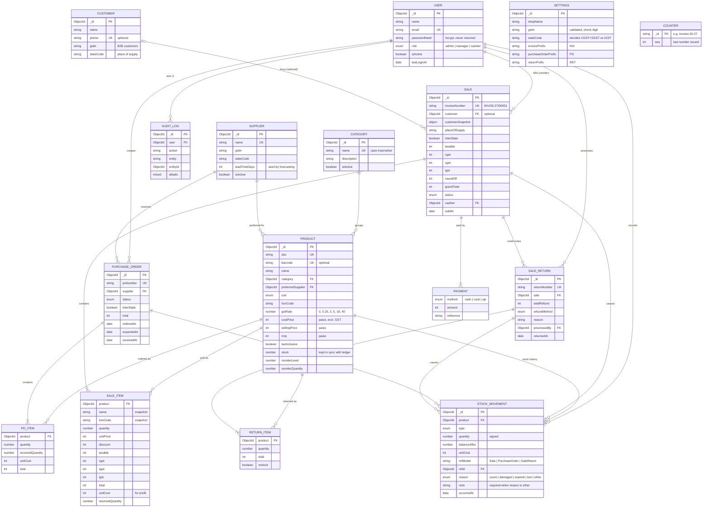

# Database Design

The system uses **MongoDB** (a document database) through the **Mongoose** ODM. Schemas live in
[`apps/api/src/models`](../apps/api/src/models).

## Entity-relationship diagram

Boxes ending in `_ITEM`, `PAYMENT` and similar are **embedded** sub-documents stored inside their
parent document. All other boxes are separate collections linked by ObjectId references.
A PNG version for reports is in [`images/er-diagram.png`](images/er-diagram.png).

## Collections

| Collection       | Purpose                                                           |
| ---------------- | ----------------------------------------------------------------- |
| `users`          | Staff accounts and roles                                          |
| `settings`       | One document: shop name, GSTIN, state, document prefixes          |
| `counters`       | Atomic sequence numbers for invoices, purchase orders and returns |
| `categories`     | Product groups                                                    |
| `suppliers`      | Vendors, with GSTIN and lead time                                 |
| `products`       | The catalogue, prices, tax and current stock                      |
| `customers`      | Optional on a sale; GSTIN and state for B2B invoices              |
| `sales`          | Invoices with embedded line items and payments                    |
| `salereturns`    | Credit notes against earlier sales                                |
| `purchaseorders` | Orders to suppliers with embedded line items                      |
| `stockmovements` | The stock ledger: one immutable entry per stock change            |
| `auditlogs`      | Who changed what, for sensitive actions                           |

## Design decisions

### Money is stored in paise

All amounts are **integers in paise** (₹1 = 100 paise). Floating-point numbers cannot represent
values like 0.1 exactly, so adding prices as decimals slowly drifts (0.1 + 0.2 = 0.30000000000000004).
Integers never drift. The API and UI convert to rupees only for display.

### Embed vs reference

- **Embedded**: invoice lines, payments, purchase-order lines and return lines. They are always
  read together with their parent, never on their own, and a sale must be saved atomically with
  its lines.
- **Referenced**: products, customers, suppliers and users. They are shared by many documents and
  edited on their own.

### Snapshots on invoices

A sale line copies the product's name, SKU, HSN code, price, tax rate and cost **at the time of
sale**. An issued invoice is a legal document, so renaming a product or changing its price later
must never alter past invoices or profit reports.

### The stock ledger

`products.stock` is never edited directly. Every change (opening stock, purchase receipt, sale,
customer return, adjustment) writes a `StockMovement` with the signed quantity and the balance
after it, **in the same MongoDB transaction** as the stock update. So:

- current stock can always be explained ("why do we have 14?");
- the stock of any product on any past date can be reconstructed;
- stock valuation and shrinkage reports come straight from the ledger;
- adjustments require a reason (stock count, damaged, expired, lost, other), which discourages
  silent edits and lets reports separate shrinkage from counting errors.

All stock changes go through one function (`recordMovement` in
`apps/api/src/modules/inventory/ledger.ts`). It applies the change with a single atomic update
that only succeeds if enough stock remains, so two cashiers selling the last unit at the same
moment cannot both succeed. A second guard in the schema (`balanceAfter` cannot be negative)
backs it up.

Transactions need a replica set, so Docker Compose runs MongoDB as a single-node replica set.

### Document numbers

Invoice numbers follow the GST rules: unique within a **financial year** (April to March) and at
most 16 characters, e.g. `INV/26-27/00042`. A `counters` document per type and year (for example
`invoice:26-27`) is incremented atomically with `findOneAndUpdate($inc)`, so two cashiers billing
at the same moment can never get the same number. Inside a sale transaction, an aborted sale also
rolls back its number, so numbering stays gap-free.

### GST

- The shop's state (`settings.stateCode`) is compared with the customer's state (place of supply):
  same state means CGST + SGST at half the rate each, different states means IGST.
- GSTINs are validated for format **and** their check character, and their first two digits must
  match the chosen state.
- Products carry an HSN code and one of the current GST slabs (0, 0.25, 3, 5, 18, 40%).

### Business time vs record time

Sales have `soldAt`, movements `occurredAt` and purchase orders `orderedAt`/`receivedAt`. These
are separate from `createdAt`, so back-dated entries (and the seed history) keep their real
business dates. Dates are stored in UTC and grouped into days in **IST**.

## Indexes

| Collection                | Index                                       | Used for                                |
| ------------------------- | ------------------------------------------- | --------------------------------------- |
| `users`                   | `email` (unique)                            | Login                                   |
| `products`                | `sku` (unique), `barcode` (unique, partial) | Barcode scan at POS, lookups            |
| `products`                | text on `name`, `brand`, `sku`              | Product search                          |
| `products`                | `category, isActive`                        | Category filters                        |
| `sales`                   | `invoiceNumber` (unique)                    | Invoice lookup                          |
| `sales`                   | `soldAt`                                    | Date-range reports, dashboard           |
| `sales`                   | `items.product, soldAt`                     | Per-product daily demand (forecasting)  |
| `sales`                   | `customer, soldAt`                          | Customer purchase history               |
| `stockmovements`          | `product, occurredAt`                       | Product stock history                   |
| `stockmovements`          | `refModel, refId`                           | Movements caused by a document          |
| `purchaseorders`          | `status, expectedAt`                        | Pending deliveries                      |
| `categories`, `suppliers` | `name` (unique, case-insensitive)           | Prevent duplicates like "Dairy"/"dairy" |

## Demo data

`npm run seed -- --reset` fills the database with a simulated year of trading for a supermarket
in Bengaluru ([`apps/api/src/seed`](../apps/api/src/seed)). It is generated by simulating each
day, not by inserting random rows:

1. Goods ordered earlier arrive from suppliers after their lead time.
2. Customers buy from what is actually in stock; when something runs out, that sale is lost.
3. At closing, anything at or below its reorder level is reordered, one purchase order per supplier.
4. A few bills are returned within days, and occasional stock is written off.

The demand follows realistic patterns, which the forecasting module later has to learn:

- **Weekly**: weekends get about 1.5 times the customers of a Monday.
- **Monthly**: busier in the first week after salaries are paid.
- **Seasonal**: cold drinks peak in April–May, tea and coffee in winter, mosquito repellent in the
  monsoon, notebooks in June when schools reopen.
- **Festivals**: footfall builds up before Diwali, Dussehra, Ganesh Chaturthi, Eid, Holi and others;
  sweets, dry fruits, ghee and LED bulbs sell several times more.
- **Trends**: some products grow (energy drinks, chips) and some decline (hand-wash refills).
- **Demo scenarios**: two products stopped selling months ago (dead stock), and three were not
  reordered recently, so they are low or out of stock.

The result is internally consistent: for every product, stock equals the sum of its ledger
entries; every invoice adds up; numbers are gap-free per financial year. These properties are
checked by automated tests (`apps/api/test/seed.test.ts`). The same `--seed` value always
produces the same data.

Brands, businesses and people in the demo data are fictional.
