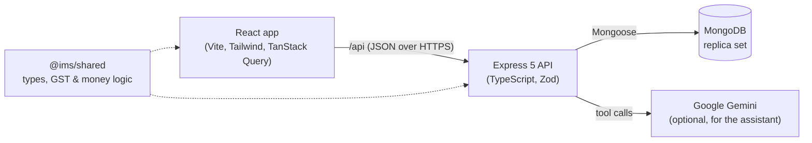
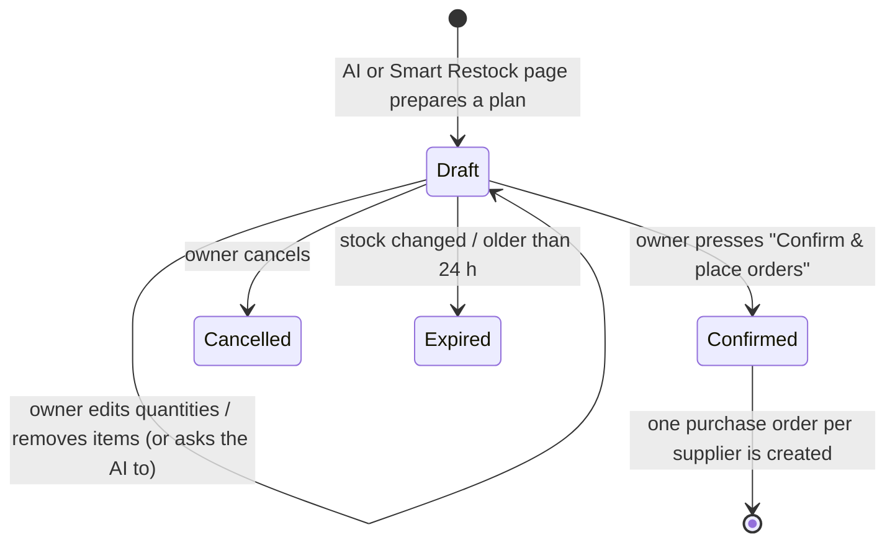

# Project Plan: Digital Inventory & Sales Management System

A web application for a retail store to manage products, stock, purchases and sales,
generate GST-compliant invoices, and use AI to forecast demand and answer business questions.

## 1. Goals

- Replace manual stock registers and billing with one system.
- Keep stock accurate: every change is recorded and explained.
- Produce GST invoices and tax summaries ready for filing.
- Help the owner decide **what to reorder and when** (AI demand forecasting).
- Let the owner ask questions in plain English (AI assistant).

## 2. Users and roles

| Capability                             | Admin | Manager | Cashier |
| -------------------------------------- | :---: | :-----: | :-----: |
| Manage users and shop settings         |   ✓   |         |         |
| Manage products, categories, suppliers |   ✓   |    ✓    |         |
| Adjust stock, receive purchases        |   ✓   |    ✓    |         |
| Make sales (POS), process returns      |   ✓   |    ✓    |    ✓    |
| View reports, forecasts, assistant     |   ✓   |    ✓    |         |

## 3. Modules

| Module                | Description                                                                                                                                                            |
| --------------------- | ---------------------------------------------------------------------------------------------------------------------------------------------------------------------- |
| Auth & roles          | JWT login (access + refresh tokens), bcrypt password hashing, role-based access                                                                                        |
| Products              | SKU, barcode, name, category, brand, unit, HSN code, GST rate, cost price, selling price, tax-inclusive flag, reorder level, image                                     |
| Categories, suppliers | Master data; suppliers carry GSTIN, state and lead time                                                                                                                |
| Inventory ledger      | Every stock change is a `StockMovement` (opening, purchase, sale, sale return, purchase return, adjustment). Current stock is kept in sync inside the same transaction |
| Purchases             | Purchase orders → receive goods → stock goes up                                                                                                                        |
| Sales / POS           | Barcode/keyword search, cart, discounts, GST, cash/card/UPI, printable invoice                                                                                         |
| Returns               | Linked to the original invoice; stock goes back up                                                                                                                     |
| Customers             | Optional on a sale; GSTIN and state decide CGST+SGST vs IGST; purchase history                                                                                         |
| Dashboard & reports   | Sales, profit, top products, GST summary, stock valuation, low stock; CSV/PDF export                                                                                   |
| AI: Smart Restock     | Forecasts demand and prepares restock purchase orders; the owner reviews and confirms                                                                                  |
| AI: Assistant         | Gemini-powered chat: answers questions and prepares restock plans on request                                                                                           |
| Audit log             | Who changed what and when                                                                                                                                              |

## 4. India / GST rules

- Money is stored as integer **paise** to avoid rounding errors; shown as ₹1,23,456.00.
- GST slabs (after the September 2025 rationalisation): **0%, 5%, 18%, 40%**, plus the special
  **0.25% and 3%** rates for precious stones and metals.
- Seller and buyer in the **same state** → CGST + SGST (half the rate each).
  **Different states** → IGST at the full rate.
- Each product has an **HSN code**; the invoice shows the shop's **GSTIN** and place of supply.
- Prices can be entered tax-inclusive (MRP style) or tax-exclusive.

The pure calculations live in `packages/shared/src/gst.ts` and are unit tested.

## 5. Architecture

- **Monorepo** with npm workspaces: `apps/api`, `apps/web`, `packages/shared`.
- **MongoDB transactions** make each sale, purchase receipt and return all-or-nothing, so stock
  never drifts. Transactions require a replica set; Docker Compose runs a single-node one.
- **Validation** with Zod on every request; consistent error shape `{ error: { code, message } }`.

## 6. Data model (collections)

`users`, `settings`, `counters`, `categories`, `suppliers`, `products`, `customers`,
`purchaseorders`, `sales`, `salereturns`, `stockmovements`, `auditlogs`

The ER diagram and design decisions are in [DATABASE.md](DATABASE.md).

## 7. AI features

The headline feature is an **AI restocking agent**: the owner asks, the AI analyses past demand and
prepares the purchase orders, and the owner confirms before anything is ordered.

### 7.1 Demand forecasting engine (machine learning, runs in the API)

- Daily sales per product are aggregated from `sales` (IST calendar days).
- **Holt-Winters exponential smoothing** (level + trend + weekly seasonality) forecasts demand for
  the coming days, with a confidence band; a moving average is used for products with little
  history. Known festival dates add an uplift learned from past festivals.
- **Reorder point** = expected demand during the supplier's lead time + safety stock
  (safety stock = z × σ × √lead time, z = 1.65 for a 95% service level).
- **Order quantity** = demand over lead time + review period + safety stock − stock on hand −
  quantity already on order (open purchase orders), rounded up to the pack size.
- Also produces: days until stockout, dead stock (no sales for a long time: never reordered).
- Accuracy is reported as **MAPE** on a hold-out period, for the project report.
- No external service and no cost; works without any AI key.

### 7.2 Restock plans with owner confirmation (human in the loop)

A **restock plan** is a stored draft: items grouped by supplier, with stock on hand, average daily
sales, days until stockout, suggested quantity, cost incl. GST, and a one-line reason per item
(e.g. "sales up 40% this month; supplier takes 3 days").

- **Only a person can confirm.** Confirming is a separate API endpoint that requires the
  `purchases:manage` permission and is called by the owner's button press. The AI's tools can
  create and edit drafts but have no way to confirm, so it can never place an order by itself.
- Confirmation re-checks stock and open orders, then creates the purchase orders in one
  transaction and writes an audit log entry ("restock plan confirmed by …").
- The **Smart Restock** page shows and confirms the same plans without the chat.

### 7.3 Proactive alerts

- The API checks stock after sales and on a schedule. When items are forecast to run out within
  their supplier's lead time, the dashboard shows a banner: "6 items need restocking: review plan".
- The alert opens a ready-made draft plan; it still needs the owner's confirmation.

### 7.4 "Ask your Inventory" assistant (Google Gemini)

- Chat panel for admins and managers, using **Google Gemini** (free tier via a Google AI Studio API
  key in `GEMINI_API_KEY`). Behind a small provider interface, so another model could be swapped in.
- The model is given **tools** that call our own services: sales summary, top products, low stock,
  forecasts, GST summary, `create_restock_plan` and `update_restock_plan`. It never invents numbers.
- Example: "Can you restock based on previous demand? Keep it under ₹50,000" → the AI calls
  `create_restock_plan` → the chat shows the plan as an interactive card with editable quantities
  and a **Confirm & place orders** button → "make the oil 100" → `update_restock_plan`.
- Without `GEMINI_API_KEY` the chat is hidden and everything else, including Smart Restock, works.
- Privacy note: chat questions and the summary figures the tools return are sent to Google.
  Check Google's terms for the free tier before using real shop data.

## 8. Quality bar

- TypeScript strict mode everywhere; ESLint + Prettier.
- Unit tests (Vitest), API tests (Supertest), end-to-end tests (Playwright).
- GitHub Actions CI on every push: format, lint, typecheck, test, build, Docker build.
- Responsive UI with light and dark mode.
- Seed script with realistic demo data and demo logins for each role.

## 9. Build order

- [x] **1. Scaffolding**: monorepo, tooling, Docker Compose, CI, README, health check
- [x] **2. Data models + seed data** (with ER diagram): see [DATABASE.md](DATABASE.md)
- [x] **3. Auth + roles**: see [AUTH.md](AUTH.md)
- [x] **4. Products, categories, suppliers** (API + UI): see [API.md](API.md)
- [x] **5. Inventory ledger + stock adjustments**: stock history, counts, write-offs, valuation
- [x] **6. Purchase orders**: drafts, GST, partial deliveries, weighted-average cost
- [x] **7. POS + GST invoice PDF**: barcode billing, split payments, IGST for other states, invoice PDF
- [ ] **8. Returns + customers**
- [ ] **9. Dashboard, reports, exports**
- [ ] **9.5 AI: Forecasting engine, restock plans with confirmation, proactive alerts**
- [ ] **9.6 AI: Gemini assistant that answers questions and prepares restock plans**
- [ ] **10. End-to-end tests, docs (SRS, DFD, use-case, sequence diagrams), screenshots, deployment**
