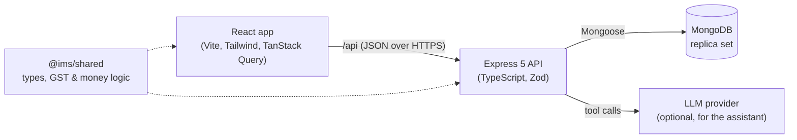

# Project Plan: Digital Inventory & Sales Management System

A web application for a retail store to manage products, stock, purchases and sales,
generate GST-compliant invoices, and use AI to forecast demand and answer business questions.

## 1. Goals

- Replace manual stock registers and billing with one system.
- Keep stock accurate: every change is recorded and explained.
- Produce GST invoices and tax summaries ready for filing.
- Help the owner decide **what to reorder and when** (AI demand forecasting).
- Let the owner ask questions in plain English (AI assistant).

## 2. Users and roles

| Capability                             | Admin | Manager | Cashier |
| -------------------------------------- | :---: | :-----: | :-----: |
| Manage users and shop settings         |   ✓   |         |         |
| Manage products, categories, suppliers |   ✓   |    ✓    |         |
| Adjust stock, receive purchases        |   ✓   |    ✓    |         |
| Make sales (POS), process returns      |   ✓   |    ✓    |    ✓    |
| View reports, forecasts, assistant     |   ✓   |    ✓    |         |

## 3. Modules

| Module                | Description                                                                                                                                                            |
| --------------------- | ---------------------------------------------------------------------------------------------------------------------------------------------------------------------- |
| Auth & roles          | JWT login (access + refresh tokens), bcrypt password hashing, role-based access                                                                                        |
| Products              | SKU, barcode, name, category, brand, unit, HSN code, GST rate, cost price, selling price, tax-inclusive flag, reorder level, image                                     |
| Categories, suppliers | Master data; suppliers carry GSTIN, state and lead time                                                                                                                |
| Inventory ledger      | Every stock change is a `StockMovement` (opening, purchase, sale, sale return, purchase return, adjustment). Current stock is kept in sync inside the same transaction |
| Purchases             | Purchase orders → receive goods → stock goes up                                                                                                                        |
| Sales / POS           | Barcode/keyword search, cart, discounts, GST, cash/card/UPI, printable invoice                                                                                         |
| Returns               | Linked to the original invoice; stock goes back up                                                                                                                     |
| Customers             | Optional on a sale; GSTIN and state decide CGST+SGST vs IGST; purchase history                                                                                         |
| Dashboard & reports   | Sales, profit, top products, GST summary, stock valuation, low stock; CSV/PDF export                                                                                   |
| AI: Smart Restock     | Demand forecast per product, days-until-stockout, reorder suggestions, dead stock                                                                                      |
| AI: Assistant         | Chat that answers questions by calling the app's own report/forecast APIs                                                                                              |
| Audit log             | Who changed what and when                                                                                                                                              |

## 4. India / GST rules

- Money is stored as integer **paise** to avoid rounding errors; shown as ₹1,23,456.00.
- GST slabs (after the September 2025 rationalisation): **0%, 5%, 18%, 40%**, plus the special
  **0.25% and 3%** rates for precious stones and metals.
- Seller and buyer in the **same state** → CGST + SGST (half the rate each).
  **Different states** → IGST at the full rate.
- Each product has an **HSN code**; the invoice shows the shop's **GSTIN** and place of supply.
- Prices can be entered tax-inclusive (MRP style) or tax-exclusive.

The pure calculations live in `packages/shared/src/gst.ts` and are unit tested.

## 5. Architecture

- **Monorepo** with npm workspaces: `apps/api`, `apps/web`, `packages/shared`.
- **MongoDB transactions** make each sale, purchase receipt and return all-or-nothing, so stock
  never drifts. Transactions require a replica set; Docker Compose runs a single-node one.
- **Validation** with Zod on every request; consistent error shape `{ error: { code, message } }`.

## 6. Data model (collections)

`users`, `settings`, `counters`, `categories`, `suppliers`, `products`, `customers`,
`purchaseorders`, `sales`, `salereturns`, `stockmovements`, `auditlogs`

The ER diagram and design decisions are in [DATABASE.md](DATABASE.md).

## 7. AI features

### 7.1 Smart Restock (demand forecasting)

- Daily sales per product are aggregated from `sales`.
- **Holt-Winters exponential smoothing** (level + trend + weekly seasonality) forecasts the next
  7–30 days with a confidence band. Falls back to a moving average for products with little history.
- **Reorder point** = expected demand during supplier lead time + safety stock
  (safety stock = z × σ × √lead time, z = 1.65 for a 95% service level).
- Outputs: days until stockout, suggested order quantity, one-click purchase order, dead-stock list.
- Accuracy reported as **MAPE** on a hold-out period (for the project report).
- Runs inside the API: no external service, no cost.

### 7.2 "Ask your Inventory" assistant

- Chat panel; the LLM is given **tools** that call our own endpoints (sales summary, top products,
  low stock, forecasts, GST summary). It never invents numbers.
- Read-only: the assistant cannot change data.
- Provider is configurable through environment variables; the app works without it.

## 8. Quality bar

- TypeScript strict mode everywhere; ESLint + Prettier.
- Unit tests (Vitest), API tests (Supertest), end-to-end tests (Playwright).
- GitHub Actions CI on every push: format, lint, typecheck, test, build, Docker build.
- Responsive UI with light and dark mode.
- Seed script with realistic demo data and demo logins for each role.

## 9. Build order

- [x] **1. Scaffolding**: monorepo, tooling, Docker Compose, CI, README, health check
- [x] **2. Data models + seed data** (with ER diagram): see [DATABASE.md](DATABASE.md)
- [ ] **3. Auth + roles**
- [ ] **4. Products, categories, suppliers** (API + UI)
- [ ] **5. Inventory ledger + stock adjustments**
- [ ] **6. Purchase orders**
- [ ] **7. POS + GST invoice PDF**
- [ ] **8. Returns + customers**
- [ ] **9. Dashboard, reports, exports**
- [ ] **9.5 AI: Smart Restock forecasting**
- [ ] **9.6 AI: Assistant**
- [ ] **10. End-to-end tests, docs (SRS, DFD, use-case, sequence diagrams), screenshots, deployment**
